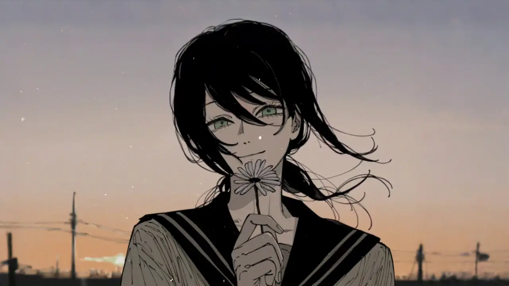

# ☾ NuviX Rice

Arch Linux + Hyprland + Serpantinum, con **29 temas animados**: el fondo decide los colores de todo el escritorio.

**Página:** https://nuvix16.github.io/Rice-NuviX/

- Fondos en video 1080p60, que cambian solos (claros de día, oscuros de noche).
- Cada tema reparte su paleta a la barra, los bordes de Hyprland, kitty, starship, fastfetch, rofi, el bloqueo, SDDM, VS Code, Spotify, Obsidian, Vesktop, GTK/Qt y el bot de Discord.
- Las «escenas» de Wallpaper Engine se convirtieron a video con `linux-wallpaperengine` grabando una pantalla virtual de Hyprland (y armando a mano los modelos que no soporta).
- 45 retratos para fastfetch, rofi, el bloqueo, Discord y stickers.

Los fondos y el arte son de sus autores (Steam Workshop, Pinterest, MoeWalls); aquí solo muestro cómo los uso.
