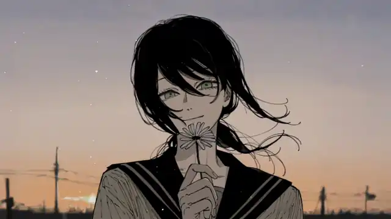
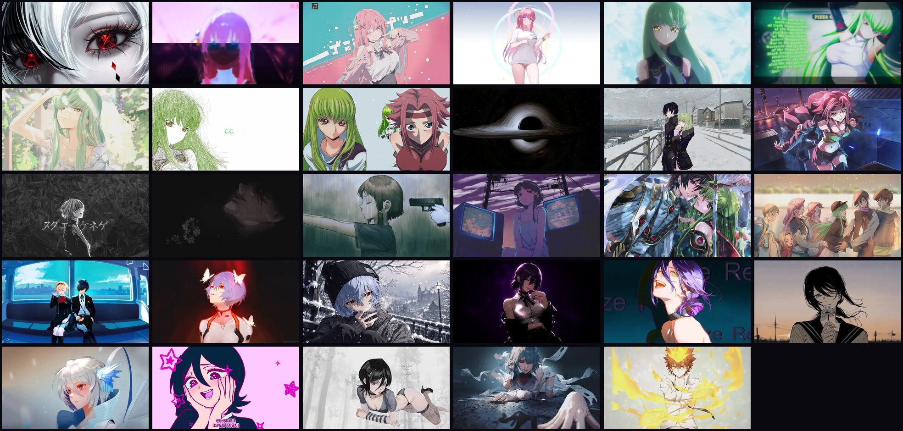

<p align="center">
  <a href="https://nuvix16.github.io/Rice-NuviX/"></a>
</p>

<p align="center">
  
  
  
  
  
</p>

<p align="center"></p>

## ✨ Qué es

Mi escritorio de todos los días. Cada fondo animado trae su propia paleta y, al cambiarlo, **todo el sistema se pinta igual**: la barra, los bordes de las ventanas, la terminal, el lanzador, la pantalla de bloqueo, el login, las apps y hasta el bot de Discord.

| | |
|---|---|
| 🎞️ **29 fondos animados** | Videos 1080p60 en bucle; de día salen los claros y de noche los oscuros |
| 🎨 **Una paleta por tema** | 22 colores hechos a mano para cada fondo |
| 🔁 **Todo sincronizado** | barra, Hyprland, kitty, starship, fastfetch, rofi, SDDM, VS Code, Spotify, Obsidian, Vesktop, GTK/Qt, Brave |
| 🖼️ **45 retratos** | rotan en fastfetch, rofi y el bloqueo; también son stickers y emojis del servidor |
| 🔊 **Sonido por tema** | un sonido corto distinto suena al cambiar de fondo |
| 🎮 **Modo juego** | pausa el fondo y sube los ventiladores al abrir un juego |

## 🎨 Los 29 temas

<p align="center"></p>

Evangelion · Chainsaw Man · Code Geass · Bocchi the Rock! · Serial Experiments Lain · Tokyo Ghoul · Bleach · Katekyo Hitman Reborn! · Persona 3 · Genshin Impact

## ⚙️ Cómo funciona

```
fondo .mp4  ──►  tema .json (mismo nombre)  ──►  wallpaper-theme.sh  ──►  barra · bordes · terminal · apps · login · Discord
```

Las «escenas» de Wallpaper Engine se convirtieron a video con `linux-wallpaperengine`, grabando una pantalla virtual de Hyprland. Los modelos que ese programa no sabe dibujar se armaron desde sus piezas y su esqueleto.

## ⌨️ Atajos

| Atajo | Qué hace | Atajo | Qué hace |
|---|---|---|---|
| `SUPER+G` | juegos | `SUPER+⇧+D` | demo de los 29 temas |
| `SUPER+E` | archivos | `SUPER+⇧+R` | escena (Spotify + cava + fastfetch) |
| `SUPER+Esc` | bloquear | `SUPER+O` | ventiladores |
| `SUPER+⇧+Esc` | apagar | `SUPER+F9` | grabar |

<sub>Los fondos y el arte son de sus autores (Steam Workshop, Pinterest, MoeWalls); aquí solo muestro cómo los uso.</sub>


